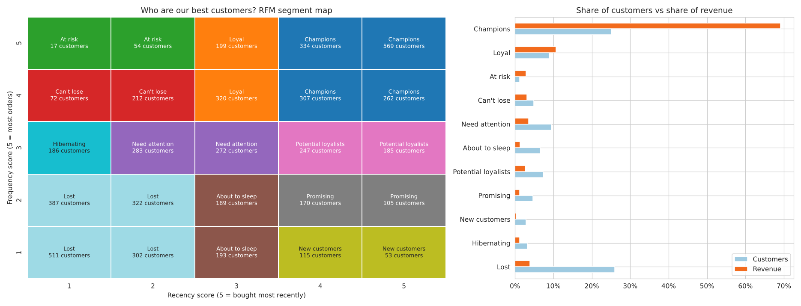
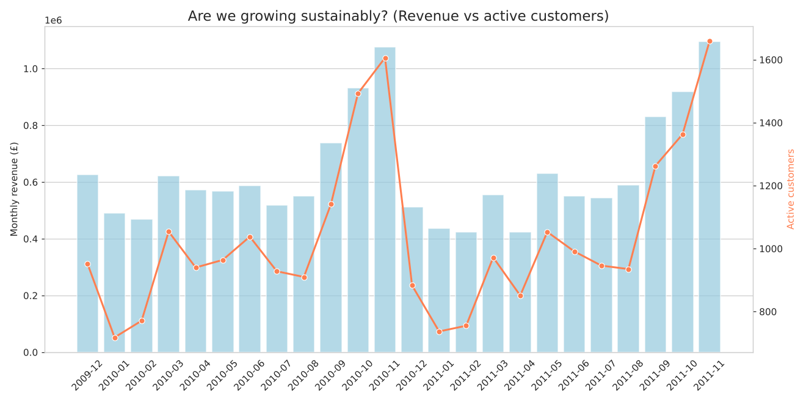
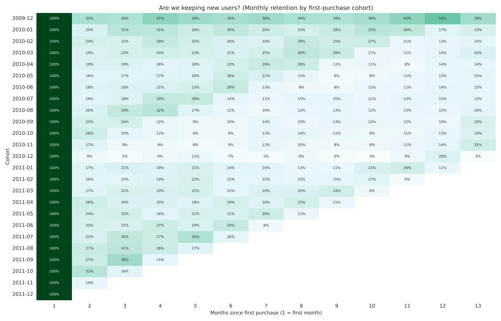

# E-Commerce Customer Map: Who to Reward, Win Back or Let Go

Raw transactions turned into a list of who to reward, who to win back and who to let go.

Data: [UCI Online Retail II](https://archive.ics.uci.edu/dataset/502/online+retail+ii), about 1 million
invoice lines from a UK online retailer, Dec 2009 to Dec 2011. After cleaning: 778,325 lines and 5,866 customers.

## Method

1. **SQLite ETL:** the raw spreadsheet is loaded into `retail.db`. SQL keeps completed sales to known
   customers (positive quantity and price, no cancellations).
2. **Outliers:** line revenue more than 3 standard deviations from the mean is dropped.
3. **RFM scoring:** each customer gets Recency (days since last order), Frequency (orders) and
   Monetary (spend). Each is **scored 1 to 5** by quintile, and recent buyers score 5 for recency.
4. **Segment map:** recency and frequency scores place each customer in one of 11 segments.
   Monetary score ranks customers inside a segment, so the biggest spenders get budget first.
5. **Action:** every segment maps to Reward, Win back, Nurture or Let go, with a priority and a suggested play.
6. **Cohorts:** monthly retention by first-purchase month.

## Results



| Segment | Customers | Share of revenue | Action |
|---|---:|---:|---|
| Champions | 1,472 (25%) | 69% | **Reward:** loyalty offers |
| Loyal | 519 (9%) | 11% | Reward |
| At risk + Can't lose | 355 (6%) | 6% | **Win back first:** were frequent, now quiet |
| Need attention + About to sleep | 937 (16%) | 5% | Win back, cheaper offers |
| Potential loyalists, Promising, New | 875 (15%) | 4% | Nurture |
| Hibernating + Lost | 1,708 (29%) | 5% | **Let go:** no paid spend |

- **Reward:** a quarter of customers, the Champions, bring in 69% of revenue. They get loyalty offers.
- **Win back:** 355 At risk and Can't lose customers were once frequent buyers and have gone quiet.
  They get the retention budget first, biggest spenders first. The list is the first rows of
  `outputs/customer_actions.csv`.
- **Let go:** 29% of customers bring in 5% of revenue. Paid marketing to them is better spent elsewhere.

### Growth



Revenue and active customers move together, with a strong Q4 peak each year. Growth comes from
more customers buying, not from bigger baskets.

### Retention



Most cohorts keep only 15 to 30% of customers in their second month. The December 2009 cohort holds
35 to 50% for a year; those are the loyal core who were already customers when the data starts.

## Outputs

- `outputs/customer_actions.csv`: every customer with R, F, M, scores, segment, action, priority and suggested play.
  Sorted so the list reads top to bottom as "spend here first".
- `outputs/segment_summary.csv`: customers, revenue share and action per segment.
- `retail.db`: the raw data plus an `rfm` table with the results (created locally, not committed).

## How to run

```bash
python3 -m venv .venv
.venv/bin/pip install -r requirements.txt
.venv/bin/python analysis.py
```

The first run downloads the dataset (45 MB) and loads it into SQLite. That takes about a minute; later runs
are quick. A local `online_retail_II.csv` or `.xlsx` is used if present. `analysis.ipynb` runs the same code
and shows the tables and plots.

**Stack:** Python, SQLite, pandas, Seaborn.
